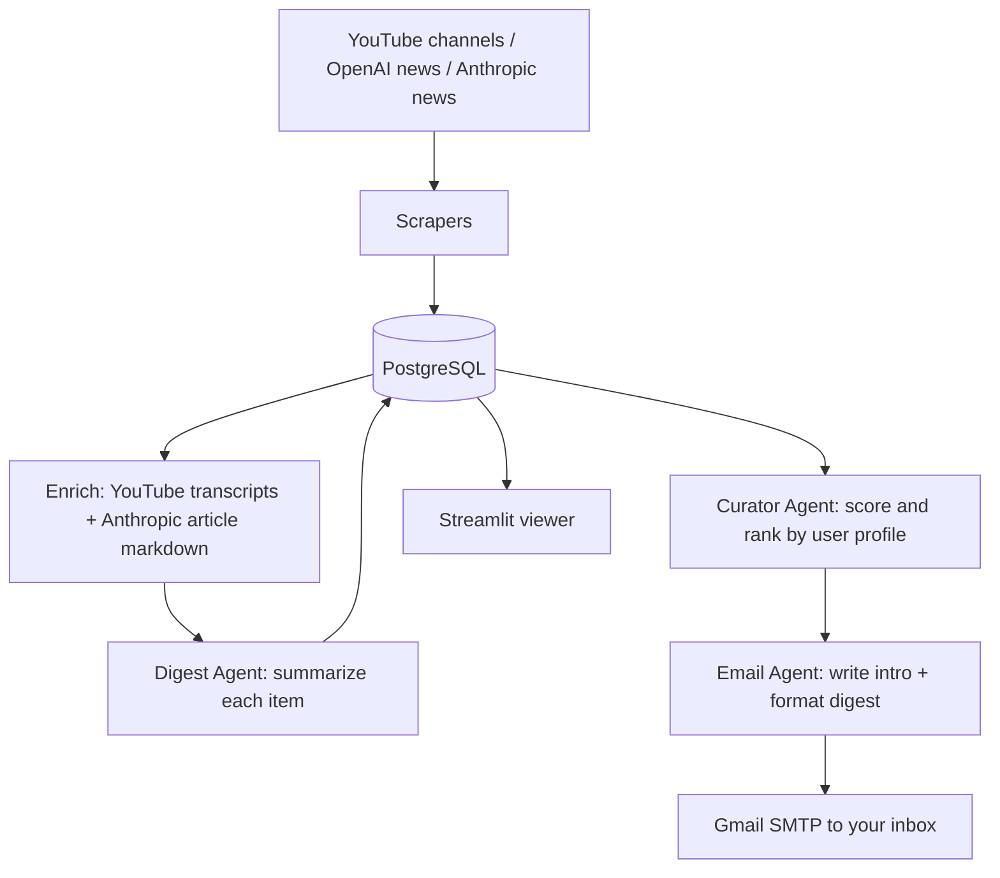

https://openai.com/news/
https://www.anthropic.com/engineering
https://www.anthropic.com/research

# AI News Aggregator

An end-to-end Generative AI pipeline that collects AI news from YouTube, OpenAI and Anthropic, summarizes every item with an LLM, ranks the summaries against a personal interest profile, and emails you a daily digest. A Streamlit page lets you browse the saved digests.

## How it works



| Stage | What happens | Code |
|-------|--------------|------|
| 1. Scrape | Pull recent items from RSS feeds and store them | `app/runner.py`, `app/scrapers/` |
| 2. Enrich | Fetch YouTube transcripts; convert Anthropic pages to Markdown (docling) | `app/services/process_youtube.py`, `app/services/process_anthropic.py` |
| 3. Digest | Summarize each item into a short title and summary | `app/agent/digest_agent.py` |
| 4. Curate | Score digests in batches of 8, then sort into a final ranking | `app/agent/curator_agent.py` |
| 5. Email | Write the intro, render HTML, send via Gmail | `app/agent/email_agent.py`, `app/services/email.py` |

## Tech stack

- Python 3.13, managed with [uv](https://docs.astral.sh/uv/)
- PostgreSQL (Docker) + SQLAlchemy
- LLM: [Groq](https://console.groq.com) through the OpenAI-compatible API (`openai/gpt-oss-120b` for ranking and emails, `openai/gpt-oss-20b` for digests), with JSON output validated by Pydantic
- feedparser, youtube-transcript-api, docling
- Streamlit for the viewer, Gmail SMTP for delivery

## Project structure

```
ai-news-aggregator/
├── main.py                  # runs the full pipeline
├── streamlit_app.py         # browse saved digests
├── pyproject.toml           # dependencies (uv)
├── requirements.txt         # same dependencies for pip users
├── docker/docker-compose.yml
└── app/
    ├── config.py            # YOUTUBE_CHANNELS list
    ├── runner.py            # scrape and save to DB
    ├── daily_runner.py      # the full 5-step pipeline
    ├── scrapers/            # youtube.py, openai.py, anthropic.py
    ├── database/            # models, connection, repository, create_tables
    ├── agent/               # llm.py, digest_agent, curator_agent, email_agent
    ├── services/            # process_* steps and email sender
    └── profiles/user_profile.py   # your interests and preferences
```

## Setup

### 1. Prerequisites

- Python 3.13+ and [uv](https://docs.astral.sh/uv/getting-started/installation/)
- Docker Desktop (running)
- A free Groq API key from console.groq.com
- For email: a Gmail account with 2-Step Verification and an [App Password](https://myaccount.google.com/apppasswords)

### 2. Install dependencies

```bash
uv sync
```

### 3. Create a `.env` file in the project root

```env
# Database (must match the Docker container below)
POSTGRES_USER=postgres
POSTGRES_PASSWORD=mypassword
POSTGRES_HOST=localhost
POSTGRES_PORT=5432
POSTGRES_DB=news_aggregator

# LLM (Groq)
GROQ_API_KEY=gsk_...
# Optional model overrides
# LLM_MODEL_SMART=openai/gpt-oss-120b
# LLM_MODEL_FAST=openai/gpt-oss-20b

# Email (Gmail App Password, not your normal password)
MY_EMAIL=you@gmail.com
APP_PASSWORD=xxxxxxxxxxxxxxxx

# Optional: only if YouTube starts blocking transcript requests
PROXY_USERNAME=
PROXY_PASSWORD=
```

Never commit `.env`. Create a `.gitignore` containing at least:

```
.env
.venv/
__pycache__/
```

### 4. Start PostgreSQL

```bash
docker run --name news-postgres -e POSTGRES_PASSWORD=mypassword -e POSTGRES_DB=news_aggregator -p 5432:5432 -d postgres
```

If the container already exists: `docker start news-postgres`.

### 5. Create the tables (once)

```bash
uv run python -m app.database.create_tables
```

## Run

Full pipeline (scrape, enrich, digest, rank, email). Arguments are hours to look back and number of articles in the email:

```bash
uv run main.py 200 10
```

Run one stage at a time while debugging (always from the project root, using `python -m`):

```bash
uv run python -m app.runner
uv run python -m app.services.process_anthropic
uv run python -m app.services.process_youtube
uv run python -m app.services.process_digest
uv run python -c "from app.services.process_curator import curate_digests; curate_digests(hours=200)"
uv run python -c "from app.services.process_email import send_digest_email; print(send_digest_email(hours=200, top_n=10))"
```

View the saved digests in the browser:

```bash
uv run streamlit run streamlit_app.py
```

The first docling run downloads models, so it is slow once.

## Customize

- **Channels:** edit `YOUTUBE_CHANNELS` in `app/config.py` (IDs start with `UC`).
- **Your interests:** edit `app/profiles/user_profile.py`. This directly changes the ranking and the email greeting.
- **Models:** set `LLM_MODEL_SMART` / `LLM_MODEL_FAST` in `.env`.

## Troubleshooting

| Problem | Fix |
|---------|-----|
| `failed to connect to the docker API` | Open Docker Desktop and wait for "Engine running" |
| `Connection refused` on port 5433 | `POSTGRES_PORT` in `.env` must equal the container's mapped port (5432) |
| Scraper returns 0 items | No new posts in that window; use a larger `hours` value |
| `429 Too Many Requests` in logs | Groq free-tier limit; the code waits and retries automatically |
| `json_validate_failed` / 400 | The model returned invalid JSON; rerun the stage, the code retries and ranking works in small batches |
| `GROQ_API_KEY` error at import | Add `GROQ_API_KEY` to `.env` |
| Gmail login error | Use an App Password and enable 2-Step Verification first |
| `ModuleNotFoundError: app` | Run from the project root with `python -m ...` or `uv run main.py` |